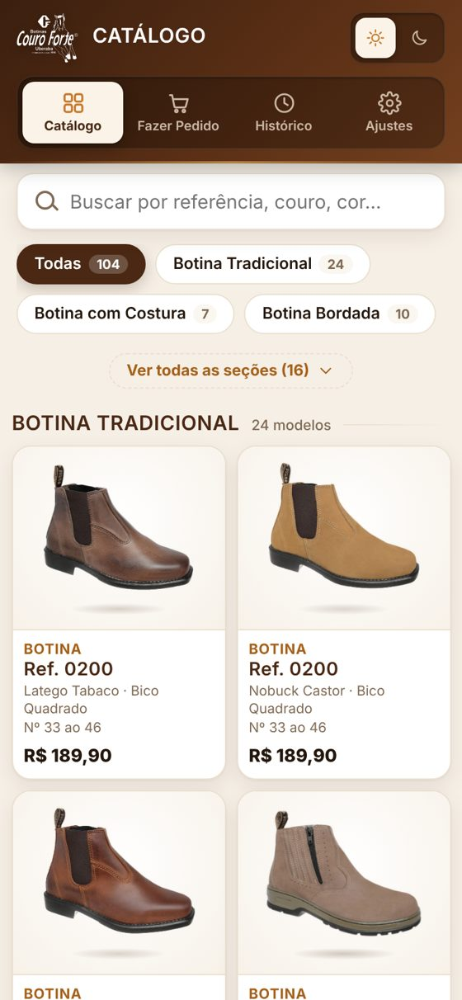
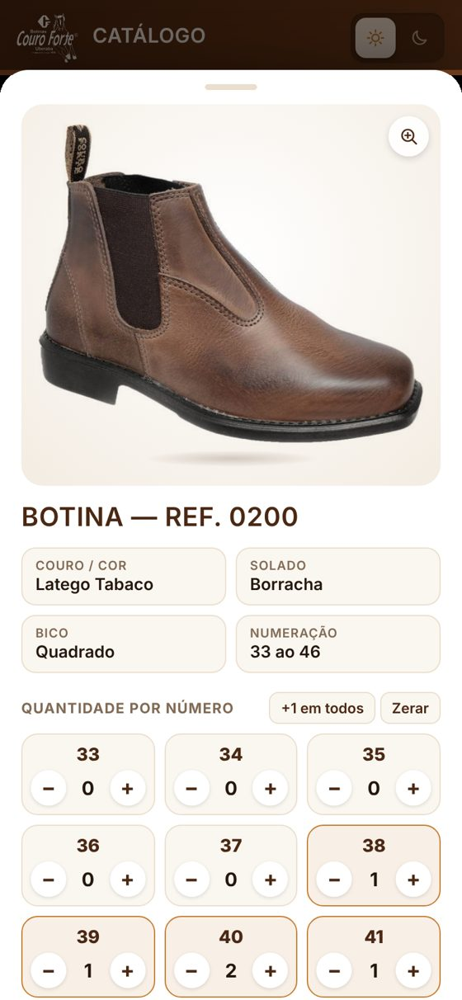
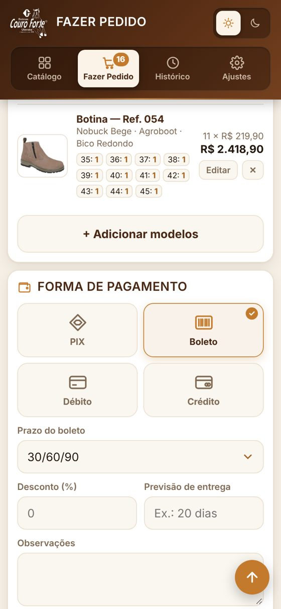
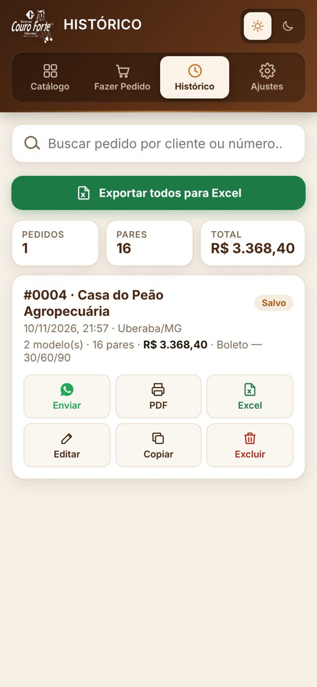
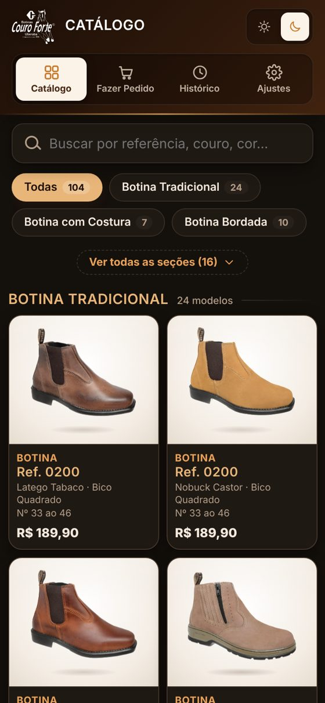
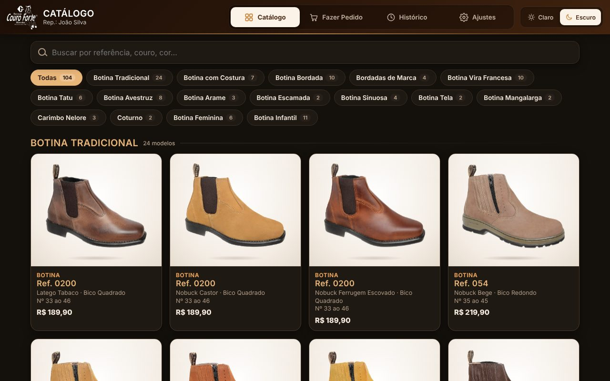

<div align="center">


# Botinas Couro Forte — Catálogo e Pedidos

**Aplicativo para os representantes da Botinas Couro Forte (Uberaba-MG): mostrar o catálogo no celular e tirar o pedido na hora, na frente do cliente.**


</div>

---

## 📱 Telas

<div align="center">

| Catálogo | Produto e grade | Pedido | Histórico | Modo escuro |
|:---:|:---:|:---:|:---:|:---:|
|  |  |  |  |  |



</div>

---

## ✨ Funcionalidades

### 👢 Catálogo
- **104 modelos** organizados em **16 seções**: Tradicional, Com Costura, Bordada, Vira Francesa, Tatu, Avestruz, Feminina, Infantil e outras.
- **Busca** por referência, couro, cor, solado ou bico.
- Fotos **ampliáveis** com animação flutuante e ficha técnica completa (couro/cor, solado, bico, numeração).
- Mostra o **preço** de cada modelo e marca os modelos que já estão no pedido.

### 🛒 Pedido
- **Grade de numeração** com botões **+ / −** para cada número e atalho "+1 em todos".
- **Cliente**: nome/razão social, CNPJ/CPF, telefone e pessoa que atendeu.
- **Estado e cidade sem digitar**: lista com as **5.570 cidades do Brasil**. Ao digitar o nome da cidade, o estado é preenchido sozinho.
- **Formas de pagamento**: PIX, Boleto (com prazo 30/60/90…), Débito e Crédito (de 1x a 12x).
- Desconto em %, previsão de entrega e observações.
- **Totais calculados na hora**: pares, subtotal, desconto e total.

### 📲 Envio para a fábrica
- **Um toque** abre o WhatsApp da Couro Forte **(34) 3315-0163** com o pedido já escrito e organizado.
- Opções de **PDF** (com logo e espaço para assinatura do cliente), **e-mail** e **copiar texto**.

### 📁 Histórico e relatórios
- Cada pedido recebe um **número** (nº 0001, 0002…) e fica salvo com o status **Salvo** ou **Enviado**.
- Ações em cada pedido: **reenviar, PDF, Excel, editar, duplicar e excluir**.
- **Exportação para Excel (.xlsx)** com duas abas:
  - **Pedidos**: um pedido por linha, com total geral.
  - **Itens e Grade**: um modelo por linha, com uma coluna para cada número.

### ⚙️ Ajustes
- Nome e telefone do representante.
- **Tabela de preços** por referência: o valor vale para todas as cores e entra sozinho no pedido.
- Forma de pagamento padrão.
- **Cópia de segurança**: exportar e importar todos os dados.

### 🎨 Experiência
- **Modo claro e modo escuro**, com as fotos sempre bem visíveis.
- **Responsivo**: funciona no celular, no tablet e no computador.
- **Funciona sem internet** depois de instalado (PWA).
- **Salvamento automático**: fechou o app, nada se perde.

---

## 🚀 Como usar

### Opção 1 — Publicar no GitHub Pages (recomendado, grátis)

1. Suba este repositório no GitHub (veja [Como subir para o GitHub](#-como-subir-para-o-github)).
2. No repositório, vá em **Settings → Pages**.
3. Em **Source**, escolha **Deploy from a branch**. Em **Branch**, escolha **`main`** e a pasta **`/ (root)`**, depois clique em **Save**.
4. Aguarde de 1 a 2 minutos. O app ficará disponível em:
   ```
   https://SEU-USUARIO.github.io/NOME-DO-REPOSITORIO/
   ```
5. Envie esse link para os representantes.

### Opção 2 — Testar no computador

Abra o arquivo `index.html` no navegador. Para testar a instalação e o modo offline, use um servidor local:

```bash
python -m http.server 8000
# acesse http://localhost:8000
```

### 📲 Instalar no celular

| Android (Chrome) | iPhone (Safari) |
|---|---|
| Abra o link → menu **⋮** → **Instalar app** / **Adicionar à tela inicial** | Abra o link → botão **Compartilhar** → **Adicionar à Tela de Início** |

O app vira um ícone com a logo da Couro Forte e funciona **mesmo sem sinal**.

---

## 🧭 Primeiro uso

1. Abra a aba **Ajustes**.
2. Preencha **seu nome** e **seu telefone**.
3. Preencha a **tabela de preços** (valor do par por referência).
4. Pronto: escolha os modelos no **Catálogo**, monte o pedido em **Fazer Pedido** e toque em **Enviar para a Couro Forte**.

---

## 💾 Onde ficam os dados

Os dados ficam **salvos no próprio celular** (localStorage do navegador) e são gravados **a cada toque**. Não há servidor nem cadastro.

| Situação | O que acontece |
|---|---|
| Fechar o app, desligar o celular | ✅ Nada se perde |
| Trocar de celular | ⚠️ Use **Ajustes → Cópia de segurança** e **Importar** no aparelho novo |
| Limpar os dados do navegador | ❌ Apaga tudo — faça cópias de segurança regularmente |

> 💡 Todo pedido enviado também fica registrado na conversa de WhatsApp da fábrica.

---

## 🗂️ Estrutura do projeto

```
📦 couro-forte-app
├── index.html          # Estrutura das telas
├── style.css           # Visual: tema claro/escuro, animações, responsivo
├── app.js              # Lógica: catálogo, pedidos, envio, Excel, ajustes
├── catalogo.js         # Lista de modelos e seções  ← edite aqui
├── cidades.js          # Estados e cidades do Brasil
├── sw.js               # Funcionamento offline (Service Worker)
├── manifest.json       # Instalação como aplicativo (PWA)
├── lib/
│   └── xlsx.mini.min.js  # Biblioteca para gerar o Excel (SheetJS)
├── img/
│   ├── logo.png          # Logo (branca, para o cabeçalho)
│   ├── logo-escura.png   # Logo (marrom, para o PDF)
│   └── produtos/         # Fotos das botinas
├── icons/              # Ícones do aplicativo
└── docs/               # Imagens deste README
```

---

## 🛠️ Personalização

### Adicionar um modelo novo
1. Coloque a foto em `img/produtos/` (`.jpg`, de preferência com fundo branco e cerca de 640 px).
2. Em `catalogo.js`, copie a linha de um modelo parecido e ajuste os dados:
   ```js
   {"id": "botina-tatu-ref-9000-...", "secao": "Botina Tatu", "nome": "Botina Tatu", "ref": "9000",
    "solado": "Micro", "couro": "Nobuck Castor", "bico": "Quadrado", "num": [33, 46],
    "img": "img/produtos/botina-tatu-ref-9000-....jpg"}
   ```
3. Para criar uma **seção nova**, acrescente o nome na lista `SECOES` no topo do `catalogo.js`.

### Trocar o WhatsApp da fábrica
No início do `app.js`:
```js
const FABRICA_ZAP = '(34) 3315-0163';
```

### Publicar uma atualização
Sempre que alterar arquivos, troque a versão no `sw.js` (por exemplo, `courofort-v5` → `courofort-v6`). Assim os celulares baixam a versão nova na próxima vez que abrirem o app com internet.

---

## 📤 Como subir para o GitHub

### Pelo GitHub Desktop (mais fácil)
1. Instale o [GitHub Desktop](https://desktop.github.com/) e entre com sua conta.
2. **File → Add local repository** → escolha esta pasta → clique em **create a repository**.
3. Clique em **Publish repository**, escolha o nome (ex.: `couro-forte-app`) e publique.

### Pelo terminal
```bash
cd couro-forte-app
git init
git add .
git commit -m "Primeira versão do app Couro Forte"
git branch -M main
git remote add origin https://github.com/SEU-USUARIO/couro-forte-app.git
git push -u origin main
```

> ⚠️ O envio pelo site do GitHub (arrastar e soltar) aceita no máximo **100 arquivos por vez**. Como a pasta `img/produtos` tem 104 fotos, prefira o GitHub Desktop ou o terminal.

---

## 🧰 Tecnologias

- **HTML5, CSS3 e JavaScript puro**: sem frameworks e sem etapa de build.
- **PWA**: Service Worker e Web App Manifest para instalação e uso offline.
- **localStorage** para guardar os dados no aparelho.
- **[SheetJS](https://sheetjs.com/)** (Apache 2.0) para gerar os arquivos Excel.
- Fontes **Inter** e **Oswald** (Google Fonts, licença OFL).

---

## 📌 Próximos passos (ideias)

- [ ] Sincronizar os pedidos de todos os representantes num painel da fábrica
- [ ] Preços diferentes por tabela (atacado / varejo)
- [ ] Controle de estoque por número
- [ ] Assinatura do cliente na tela

---

## 📄 Licença

Software de uso exclusivo da **Botinas Couro Forte**. As fotos, a logo e a marca pertencem à empresa. Veja [LICENSE](LICENSE).

<div align="center">

---

**Botinas Couro Forte** · Uberaba-MG · Produzida desde 1990

</div>
